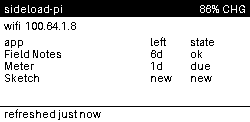
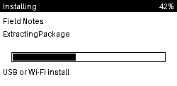
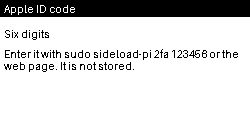
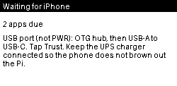
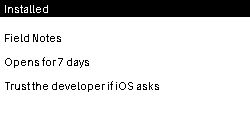
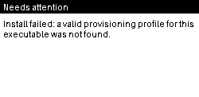

# pi-sideloader

A Raspberry Pi Zero W, a UPS-Lite v1.3, and a Waveshare 2.13 inch black-and-white e-Paper HAT that re-signs your own iOS apps and puts them back on your iPhone before the free 7-day profile runs out.

The Pi is the computer. You do not need a laptop in the bag. Plug the phone into the Pi's **USB** port (not **PWR**) when a refresh is due, or leave it paired for a later Wi-Fi attempt. The e-paper face shows what is installed, how many days are left, and a progress bar while an IPA is copying.

This is for apps you built. It will not install App Store downloads. FairPlay-encrypted IPAs are refused.

## What you need

- Raspberry Pi Zero W, Raspberry Pi OS Lite **32-bit** Bookworm or newer
- UPS-Lite v1.3 (CW2015 fuel gauge) under the Pi
- Waveshare 2.13 inch e-Paper HAT, black/white. V1, V2, V3, and V4 are all supported. The red/black "B" panel and the 212×104 "D" panel are not
- A micro-USB OTG hub (micro-USB plug to USB-A sockets) and a USB-A to USB-C cable for the iPhone
- A free Apple ID you can dedicate to this, plus an [anisette](docs/SETUP.md) server you run somewhere else (a Pi Zero cannot build Apple's identity library)

The step-by-step, including how the phone is cabled and how to tell which e-paper you have, is [docs/SETUP.md](docs/SETUP.md). Why these tools and not the others is [docs/ARCHITECTURE.md](docs/ARCHITECTURE.md). What has not been tried on real hardware is [docs/LIMITATIONS.md](docs/LIMITATIONS.md).

## Install

```sh
git clone https://github.com/Ph-ill/pi-sideloader.git
cd pi-sideloader
sudo scripts/install.sh
```

On a Pi Zero (`uname -m` is `armv6l`), this downloads a prebuilt zsign and libimobiledevice stack when `prebuilt/armv6.env` points at a published `prebuilt-*` release with a matching sha256. The archive is checked before it is copied, and the tools are run before any stamp file is written. That build is ARMv6, not Debian armhf. If the release is missing, the checksum or a member does not match, or you pass `--build-from-source`, the script compiles the pinned sources instead. `--build-from-source` also rebuilds when a stamp already matches. Compiling on the Zero takes one to two hours. The download does not.

## Screens

The pictures below are rendered with Pillow on a desktop. They are the same bitmaps the panel is sent.

| Idle | Progress | Needs a code |
| --- | --- | --- |
|  |  |  |

| Waiting for the phone | Installed | Error |
| --- | --- | --- |
|  |  |  |

Driver test cards, one per revision: [V1](docs/previews/test-v1.png), [V2](docs/previews/test-v2.png), [V3](docs/previews/test-v3.png), [V4](docs/previews/test-v4.png). On the Pi, `sudo sideload-pi display-test V1` (then V2, V3, V4) draws that card. Power-cycle between tries.

## Everyday commands

```sh
sudo sideload-pi login              # once, including the Apple verification code
sudo sideload-pi enable             # after display-test, anisette_url, and login
sudo sideload-pi add ~/Notes.ipa
sudo sideload-pi status
sudo sideload-pi refresh            # or plug the phone in and let the daemon notice
sudo sideload-pi 2fa 123456         # if a later refresh asks again
```

The local web page listens on `127.0.0.1:8741` and asks for the token in `/var/lib/sideload-pi/secrets/web.token`. Uploads are capped at 64 MB unless you raise `web.max_upload_mb`. Reach it with SSH or Tailscale, not by opening the port on a cafe network. Stop the daemon before `display-test`; it refuses to share the panel.

## License

MIT. Copyright (c) 2026 Phill Scargill. The e-paper waveforms are adapted from Waveshare's MIT demos; see [third_party/WAVESHARE.txt](third_party/WAVESHARE.txt).
